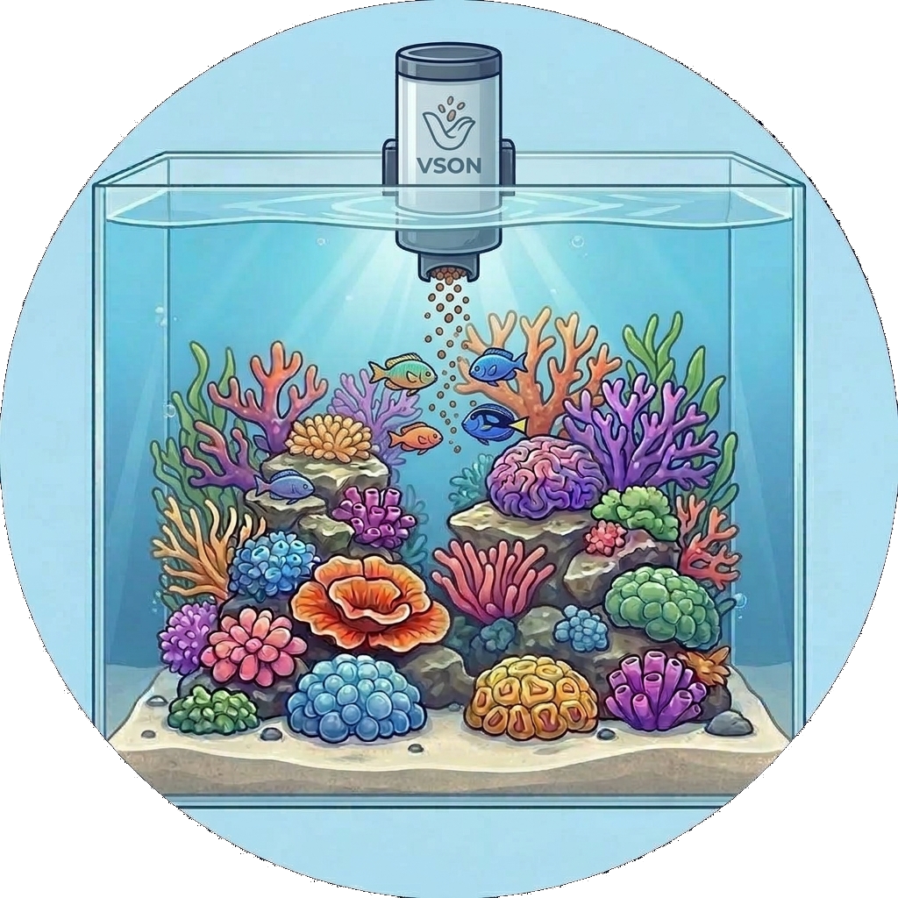
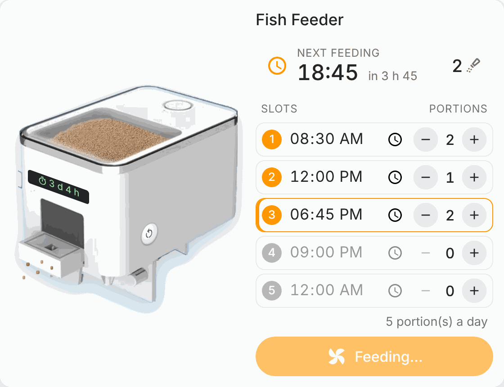

# VSON 🐟
> Part of the [**ReefTech Project Ecosystem**](https://elwinmage.github.io/reeftank/)
<p align="center">
  
</p>

[](https://developers.home-assistant.io/docs/architecture_index/#branding)
[](https://github.com/Elwinmage/ha-vson-component/releases)
[](https://github.com/Elwinmage/ha-vson-component/actions/workflows/main.yml)
[](https://github.com/Elwinmage/ha-vson-component/actions/workflows/hass_and_hacs.yml)
[](https://app.codecov.io/gh/Elwinmage/ha-vson-component)
[](https://github.com/Elwinmage/ha-vson-component)

# Supported Languages: [](https://github.com/Elwinmage/ha-vson-component/blob/main/README.md) [](https://github.com/Elwinmage/ha-vson-component/blob/main/doc/fr/README.fr.md)

Control your VSON aquarium devices from Home Assistant through the VSON cloud API (`apis.myvsoncloud.com`). The WP8621 automatic fish feeder is fully supported; every other VSON device on your account is detected generically (online state + manual refresh), and new families are easy to add.

> **Prefer no cloud?** The WP8621 feeder can instead be reflashed with local **ESPHome** firmware — same board, no chip swap, no cloud. Full procedure (UART first flash, then wireless updates), wiring and configuration: **[esphome/README.md](esphome/README.md)**.

---

<!-- ecosystem:start -->

## Related projects

The ReefTech projects fit together: the integrations bring your equipment into Home Assistant, the card displays and drives it, and the backup keeps it running through an outage. Each one also works on its own.

<p align="center"><a href="https://elwinmage.github.io/reeftank/"></a></p>

<table>
  <tr>
    <th width="100px"></th>
    <th>Project</th>
    <th>What it does</th>
    <th>Works with</th>
  </tr>
  <tr>
    <td></td>
    <td>🐠<br /><a href="https://github.com/Elwinmage/ha-reefbeat-component"><b>ha-reefbeat-component</b></a></td>
    <td>Red Sea ReefBeat devices, controlled locally with no cloud: ReefATO+, ReefControl, ReefControl-Power, ReefDose, ReefLed, ReefMat, ReefRun and ReefWave.<br />alert blueprint for abnormal modes, calibrations and low battery. <a href="https://my.home-assistant.io/redirect/blueprint_import/?blueprint_url=https://raw.githubusercontent.com/Elwinmage/ha-reefbeat-component/refs/heads/main/blueprints/automation/redsea_alerts.en.yaml"></a></td>
    <td>ha-reef-card</td>
  </tr>
  <tr>
    <td></td>
    <td>🌊<br /><a href="https://github.com/Elwinmage/ha-aquamedic-component"><b>ha-aquamedic-component</b></a></td>
    <td>Aqua Medic pumps through the Gizwits cloud API: EcoDrift and SmartDrift wavemakers, DC Runner return and skimmer pumps.</td>
    <td>ha-reef-card</td>
  </tr>
  <tr>
    <td></td>
    <td>🐟<br /><b>ha-vson-component</b><br /><i>(this repository)</i></td>
    <td>VSON automatic fish feeders through the VSON cloud API: the WP8621 feeder (feed now, battery, low-food alert), plus generic detection of any other VSON device. The WP8621 can also run fully local on ESPHome.</td>
    <td>ha-reef-card</td>
  </tr>
  <tr>
    <td></td>
    <td>🐙<br /><a href="https://github.com/Elwinmage/ha-reef-maintenance-component"><b>ha-reef-maintenance-component</b></a></td>
    <td>Cleaning and wear tracking for the equipment Home Assistant cannot talk to: flow pumps, return pumps, skimmers, media reactors, anything you service by hand.</td>
    <td>ha-reef-card</td>
  </tr>
  <tr>
    <td></td>
    <td>🪸<br /><a href="https://github.com/Elwinmage/ha-reef-card"><b>ha-reef-card</b></a></td>
    <td>Interactive graphical view of each device on your dashboard, and the only way to edit advanced schedules. Reads the three integrations above through the shared <code>reef_role</code> contract, with no card-side configuration. Also draws the power flows of reefbeatEnergyBackup. Its aquarium card brings your tank to life with ha-reeftank-component.</td>
    <td>all four integrations, and ha-reeftank-component for the aquarium</td>
  </tr>
  <tr>
    <td></td>
    <td>🐟<br /><a href="https://github.com/Elwinmage/ha-reeftank-component"><b>ha-reeftank-component</b></a></td>
    <td>A living picture of your tank on the dashboard: your photo, lit by your real lamps, with animated fish and corals, and your devices and entities on it. Stores the aquariums and their livestock, records the feedings.</td>
    <td>ha-reef-card</td>
  </tr>
  <tr>
    <td></td>
    <td>🐡<br /><a href="https://github.com/Elwinmage/reeftank-catalog"><b>reeftank-catalog</b></a></td>
    <td>Fish, corals and textures of the aquarium card, downloaded and kept up to date by ha-reeftank-component.</td>
    <td>ha-reeftank-component</td>
  </tr>
  <tr>
    <td></td>
    <td>🐬<br /><a href="https://github.com/Elwinmage/ha-reef-blueprints"><b>ha-reef-blueprints</b></a></td>
    <td>Automation blueprints shared by the whole ecosystem: overdue maintenance found through the <code>reef_role</code> contract, devices that went unreachable, a periodic heater test and a relay watch. Eight languages.</td>
    <td>all four integrations</td>
  </tr>
  <tr>
    <td></td>
    <td>⚡<br /><a href="https://github.com/Elwinmage/reefbeatEnergyBackup"><b>reefbeatEnergyBackup</b></a></td>
    <td>Battery backup for power outages. A 24V LiFePO₄ pack driven by a Raspberry Pi, with pump speed degraded progressively according to the state of charge.</td>
    <td>standalone, or alongside ha-reefbeat-component and ha-reef-card</td>
  </tr>
</table>

All of them are documented together on the [ReefTech project page](https://elwinmage.github.io/reeftank/).

<!-- ecosystem:end -->

---

## Supported devices

| Device | Model `type` | Entities |
|---|---|---|
| **WP8621 automatic fish feeder** (variants N/E/H/F/B/P/A/C) | `8621` | Feed now (button), Battery (%), Firmware, Food shortage (problem), Online, Scheduled feeding (switch), Refresh |
| **Any other VSON device** | *detected* | Online, Refresh |

The feeder is driven by the cloud's `Bley` endpoints. Other families are added in `custom_components/vson/devices.py` by declaring a new `DeviceFamily`; no change to the platforms is needed.

## How it works

Everything goes through plain HTTPS POST requests against `apis.myvsoncloud.com`, reverse-engineered from the official VSON Android app:

- credentials are 3DES-encrypted at login (there is no proprietary socket protocol);
- the session token is carried, re-encrypted, in a request header;
- the feeder's realtime state (battery, low-food, firmware) is polled from `queryBleyHomepage`, and a manual feed is `updateBleyFeed`.

No credentials or tokens ever leave your Home Assistant instance except toward the VSON cloud.

## Installation

### HACS (recommended)

1. In HACS, add this repository as a **custom repository** (category *Integration*).
2. Install **VSON**, then restart Home Assistant.
3. Go to **Settings → Devices & Services → Add Integration → VSON**.

### Manual

Copy `custom_components/vson` into your Home Assistant `config/custom_components/` folder and restart.

## Configuration

Sign in with the same **phone number or e-mail** and **password** you use in the VSON mobile app. You can tune the refresh interval (10–600 s, default 30 s) at setup and later in the integration options.

## Ecosystem integration

Every entity publishes a stable `reef_role` state attribute (e.g. `online`, `food_shortage`, `feed`). This is the shared contract the ReefTech ecosystem uses: [ha-reef-card](https://github.com/Elwinmage/ha-reef-card) and the shared blueprints discover VSON entities through it, with no per-integration configuration.

<p align="center"></p>
<p align="center"><em>The WP8621 feeder shown in <a href="https://github.com/Elwinmage/ha-reef-card">ha-reef-card</a>: next feeding, per-slot schedule and portions, and manual feed.</em></p>

## FAQ

**Is this official?** No. It is an independent, interoperability-focused integration built from the public mobile app. Use your own account.

**My feeder is not detected as a feeder.** Enable debug logging for `custom_components.vson` and open an issue with the device's `type` code — a new `DeviceFamily` can be mapped for it.

**Does it work without the cloud?** This integration talks to the VSON cloud. If you want fully local control of the WP8621, reflash it with ESPHome instead — a separate, hardware-level route documented in **[esphome/README.md](esphome/README.md)** (local only, no cloud, keeps the original chip). The two approaches are independent: use the cloud integration here, *or* the ESPHome firmware.

## Development

```bash
pip install -r requirements.test.txt
pre-commit install
pytest
```

The CI mirrors the pre-commit hooks: ruff, hassfest, HACS validation, translation check and pytest.
