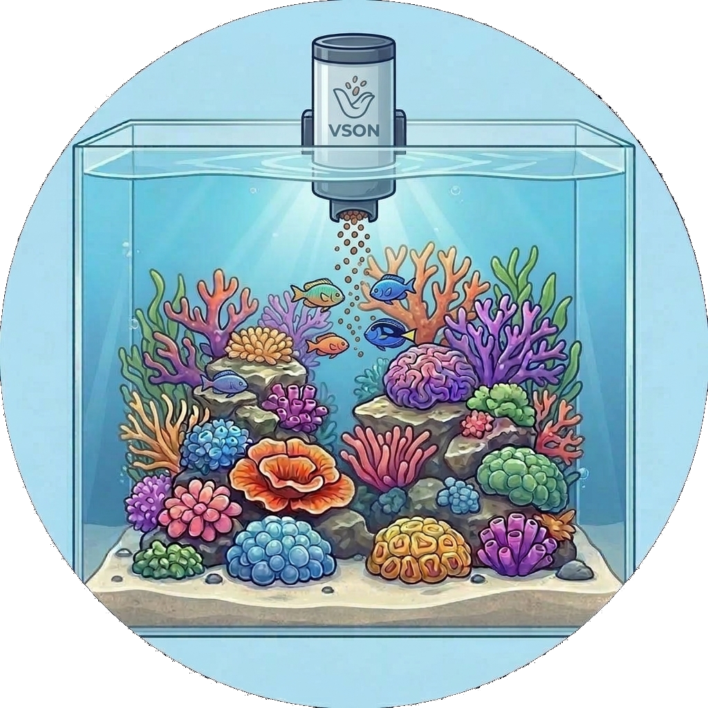

# VSON 🐟
> Fait partie de l'[**écosystème ReefTech**](https://elwinmage.github.io/reeftank/)

  

# Langues :  

Pilotez vos appareils aquariophiles VSON depuis Home Assistant via le cloud VSON (`apis.myvsoncloud.com`). Le distributeur automatique **WP8621** est entièrement pris en charge ; tout autre appareil VSON du compte est détecté de façon générique (état en ligne + rafraîchissement manuel), et de nouvelles familles s'ajoutent facilement.

## Appareils pris en charge

| Appareil | `type` modèle | Entités |
|---|---|---|
| **Distributeur WP8621** (variantes N/E/H/F/B/P/A/C) | `8621` | Nourrir maintenant (bouton), Batterie (%), Micrologiciel, Manque de nourriture (problème), En ligne, Distribution programmée (interrupteur), Rafraîchir |
| **Tout autre appareil VSON** | *détecté* | En ligne, Rafraîchir |

Le feeder utilise les endpoints `Bley` du cloud. On ajoute d'autres familles dans `custom_components/vson/devices.py` en déclarant un nouveau `DeviceFamily` ; aucune modification des plateformes n'est nécessaire.

## Fonctionnement

Tout passe par de simples requêtes HTTPS POST vers `apis.myvsoncloud.com`, rétro-conçues depuis l'application Android VSON :

- les identifiants sont chiffrés en 3DES à la connexion (aucun protocole socket propriétaire) ;
- le jeton de session est transmis, rechiffré, dans un en-tête ;
- l'état temps réel du feeder (batterie, manque de nourriture, micrologiciel) est lu via `queryBleyHomepage`, et la distribution manuelle via `updateBleyFeed`.

## Installation

### HACS (recommandé)

1. Dans HACS, ajoutez ce dépôt comme **dépôt personnalisé** (catégorie *Intégration*).
2. Installez **VSON**, puis redémarrez Home Assistant.
3. **Paramètres → Appareils et services → Ajouter une intégration → VSON**.

### Manuelle

Copiez `custom_components/vson` dans `config/custom_components/` puis redémarrez.

## Configuration

Connectez-vous avec le **numéro de téléphone ou l'e-mail** et le **mot de passe** de l'application VSON. L'intervalle de rafraîchissement (10–600 s, défaut 30 s) est réglable à l'installation puis dans les options.

## Intégration à l'écosystème

Chaque entité publie un attribut d'état `reef_role` stable (`online`, `food_shortage`, `feed`, …). C'est le contrat partagé de l'écosystème ReefTech : [ha-reef-card](https://github.com/Elwinmage/ha-reef-card) et les blueprints le découvrent sans configuration côté carte.

## FAQ

**Est-ce officiel ?** Non. Intégration indépendante d'interopérabilité, construite depuis l'application mobile publique. Utilisez votre propre compte.

**Mon feeder n'est pas détecté comme tel.** Activez les logs de debug pour `custom_components.vson` et ouvrez une issue avec le code `type` de l'appareil — une nouvelle `DeviceFamily` pourra lui être associée.

**Ça marche sans le cloud ?** Non, cette intégration parle au cloud VSON. La piste firmware local (ESPHome) pour le WP8621 est un chantier matériel distinct.
