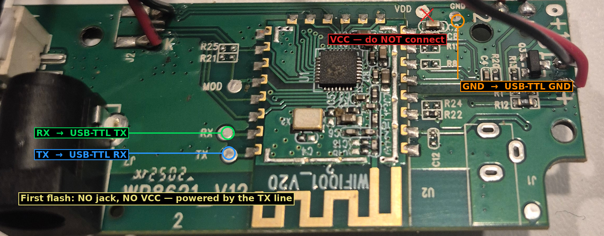

# FishFeeder — ESPHome on the stock BK7231N

Run [ESPHome](https://esphome.io) on the **VSON WP8621** automatic fish feeder
**without replacing its chip**. The feeder keeps its original Beken **BK7231N**
module (marked *BL2028N*, module *WIFI001_V20*); only the firmware changes. You
get a native Home Assistant device: on-device feeding schedule, food-level
sensor, manual feed, and the status LED — no cloud.

The firmware integrates with [ha-reef-card](https://github.com/Elwinmage/ha-reef-card)
through the project name `vson.fish_feeder`.

> **Tested only on the `WP8621_V12` board** (BK7231N / BL2028N, module
> WIFI001_V20). Other board revisions may differ — pin map, LED colors or
> sensor — so check before flashing.

## Why this needs a dedicated config

Two things make this module special, both handled by the config and the
`vson_feeder` component so you don't have to think about them:

- **Zero flash-encryption keys.** Unlike Tuya modules, this BK7231N runs the
  flash in clear text. The config builds a plain (non-encrypted) image with
  `board_build.bkcrypt_coeffs: "0000…"`. A standard (Tuya-key) image does not
  boot on it.
- **A non-Tuya bootloader that stays in place.** The stock bootloader is kept,
  and it does not understand LibreTiny's OTA package. The `vson_feeder`
  component builds the OTA image in the format this bootloader installs, so
  **after the first UART flash, every update is wireless.**

## Configuration

The device YAML is **[`fishfeeder.yaml`](fishfeeder.yaml)**. It pulls the
`vson_feeder` component and each feeding slot straight from this repository, so
it works as-is in the ESPHome Builder add-on (no local files to create):

```yaml
external_components:
  - source:
      type: git
      url: https://github.com/Elwinmage/ha-vson-component
      ref: main
      path: esphome/components
    components: [vson_feeder]

vson_feeder:

bk72xx:
  board: generic-bk7231n-qfn32-tuya
  framework:
    uart_port: 1          # logs on UART1 (P10/P11); P0/P1 drive the LEDs
```

Before building, copy `secrets.yaml.example` to `secrets.yaml` and fill in:
`wifi_ssid`, `wifi_password`, `api_encryption_key` (generate one with
`openssl rand -base64 32`, or let ESPHome suggest it when you adopt the device)
and `ap_password`. The device YAML keeps no keys in clear — it reads them with
`!secret`.

The number of feeding slots is the number of `feed_slot_*` blocks in the
`packages:` section — add or remove one to change it.

## Step 1 — First flash, over UART (once)

The first flash must be done over a wired **USB-to-UART (3.3 V)** adapter. It
writes only the app, so the stock bootloader is preserved.

### Wiring



| USB-TTL adapter | Feeder board | Where on the photo |
|---|---|---|
| TX | **RX** | middle, lower half |
| RX | **TX** | just below RX |
| GND | **GND** | top right (next to the black wire) |
| 3.3 V / VCC | — | **do not connect** |

**Do not power the board during the first flash — no DC jack, and no adapter
VCC.** In bootloader mode the module draws almost nothing and runs off the TX
line alone; adding a second supply (the jack *or* the adapter's 3.3 V) made this
unit reset instead of flashing. So connect **only GND + TX + RX**. (If your unit
stays completely dead with just those three, connect the adapter's 3.3 V to VCC
— but never together with the DC jack. The jack is for normal operation, once
the feeder is reassembled, not for the wired flash.)

> Tip: back up the original firmware first (same wiring), so you can always
> return to stock:
> `ltchiptool flash read backup.bin -f bk7231n -d /dev/ttyUSB0`

### Flash it

**Option A — from Home Assistant (ESPHome Builder).** Plug the USB-TTL adapter
into the machine running the ESPHome dashboard, then on the device choose
**Install → Plug into the computer running ESPHome Dashboard** and pick the
serial port. ESPHome flashes over UART with `ltchiptool` under the hood. When it
says *Connecting…*, **reset the module** so the ROM loader catches it: briefly
unplug and replug the adapter (that is what powers the board), a few times if
needed.

**Option B — command line.**

```bash
ltchiptool flash write firmware.uf2 -d /dev/ttyUSB0
```

Same thing: on *Connecting…*, unplug/replug the adapter until it connects. Take
the `firmware.uf2` that the ESPHome build produces.

Once flashed, put the board back in the feeder and power it normally (its DC
jack). It boots ESPHome and joins your WiFi; the blue LED stops blinking once
connected. Adopt it in Home Assistant.

## Step 2 — Updates, wireless (from now on)

No more wires. In ESPHome Builder use **Install → Wirelessly**, or let Home
Assistant offer the update. The `vson_feeder` component packs the image in the
stock bootloader's format; look for this line in the build log to confirm it
ran:

```
VSON OTA: … bytes of XZ (…%), installed by the stock bootloader
```

After *OTA successful*, the feeder stays **silent for about a minute** while the
bootloader unpacks the new firmware — **do not power it off during that time.**
An interrupted upload or a power cut is safe: the previous firmware keeps
running and the install simply restarts on the next boot.

## Status LED

A single bi-color LED (pins P0/P1):

- **Blue** blinks while WiFi is disconnected (boot included), steady once connected.
- **Red** blinks while food is missing, off otherwise.

If the colors are swapped on your unit, exchange `pin_led_blue` and
`pin_led_red` at the top of `fishfeeder.yaml`.

## Food level: calibration and alarm

The level is read optically: an IR emitter (P23) is lit for half a second every
10 s, and the receiver (P22) is sampled. The light reaches the receiver when the
hopper is **empty** (high voltage) and is blocked when **food** is in the way
(lower voltage). Three entities expose it:

- **Food Sensor Voltage** (diagnostic) — the raw reading, ~2.4 V when empty.
- **Food Level Sensor** (problem) — *on* = food is missing.
- **Food Sensor Threshold** (config, V) — food is reported missing when the
  voltage rises **above** this. Default 1.6 V.

**Calibrating.** Empty the hopper, then press the **Food Sensor Calibration**
button. It reads the empty level and sets the threshold to **two-thirds** of it
(the rule the stock firmware uses), so a filled hopper — which reads lower —
stays below the threshold and does not alarm. Do it once per unit, and again if
you change the type of food or the ambient light. If the hopper is not actually
empty (reading too low) the calibration is ignored and logs a warning.

**Food Sensor Delay** (config, s, 3–30). This is a debounce: the level must stay
past the threshold **this long** before the alarm arms or clears, which stops it
flickering on a borderline reading. Since the sensor is read every 10 s, a value
under 10 s just means "confirm on the next reading"; 25 s ≈ three readings in a
row, like the stock firmware.

## MAC address — unique per feeder

LibreTiny gives every BK7231N the same default MAC (`C8:47:8C:42:00:48`), and
this chip exposes no unique hardware ID to build one from (no eFuse MAC, no
flash unique-ID). Several feeders on one network would therefore clash.

The `vson_feeder` component fixes this: it derives a stable, locally-administered
MAC from the device's ESPHome **name** and applies it. So give each feeder a
**distinct `name:`** — you already do, one YAML per device — and each gets its
own MAC, the same across reboots. Check it in the boot log:

```
[wifi] MAC Address: 02:…
```

Set `unique_mac: false` under `vson_feeder:` to keep LibreTiny's default.

## Hardware wiring (motor, sensors)

Opening the feeder and the connections of the motor, trap switch and food
sensor are described in the Home Assistant community thread:
[VSON WP8621 V1.2 fish feeder](https://community.home-assistant.io/t/vson-wp8621-v12-fish-feeder/759621).
The pin map used by this firmware (read from the stock firmware) is at the top
of `fishfeeder.yaml`.

## Troubleshooting

- **The old firmware boots again after an OTA.** The OTA image was not in the
  stock-bootloader format. Check the `VSON OTA:` line is in the build log; if
  not, the component is served from cache — set `refresh: always` on the
  `vson_feeder` external component for one build.
- **`ltchiptool` never connects.** Keep only GND + TX + RX (no jack, no VCC) and
  unplug/replug the adapter while it says *Connecting…*. If still nothing, swap
  the board's RX/TX. If the board seems dead, add the adapter's 3.3 V to VCC
  (without the jack).
- **Nothing boots after flashing.** Re-flash; an unstable supply during the
  write can leave an incomplete image. Once flashed, remember the app itself
  needs real power — run it from the feeder's DC jack, not from the TX line.
